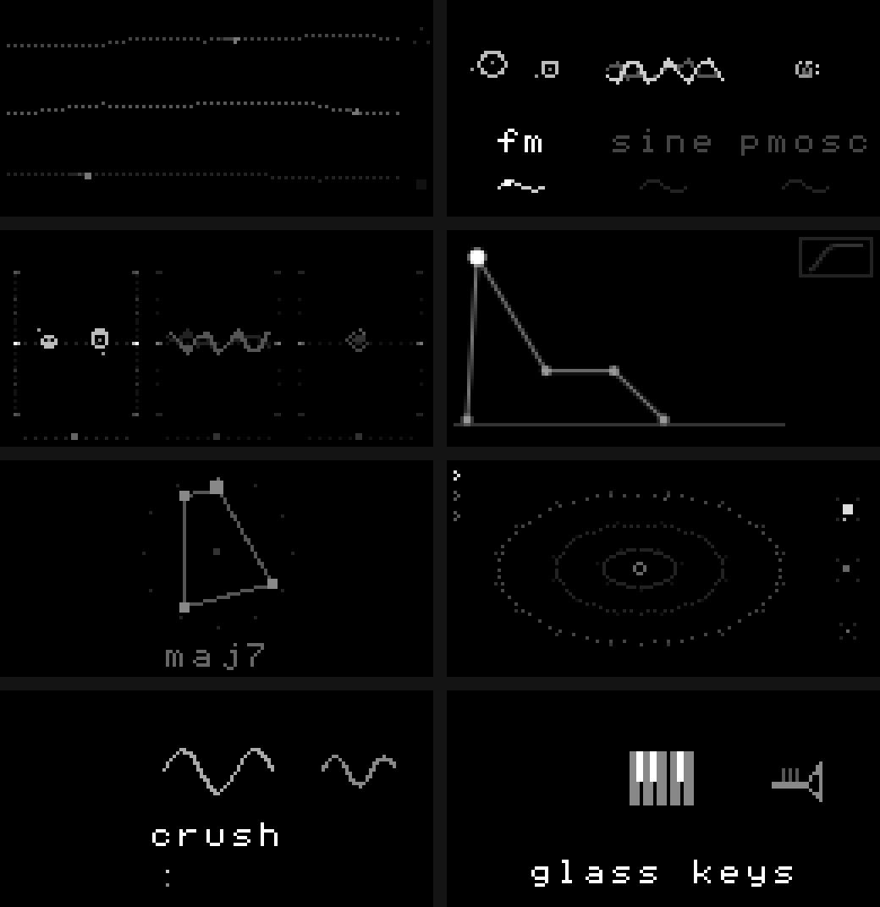
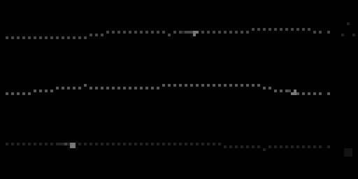
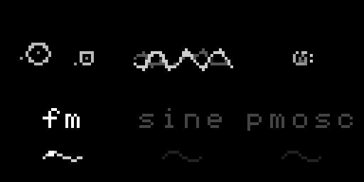
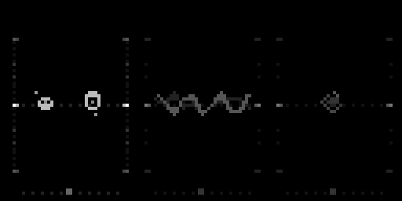
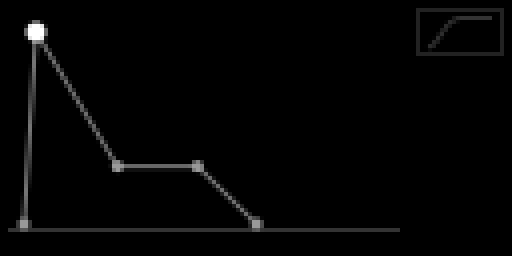
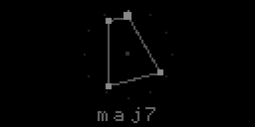
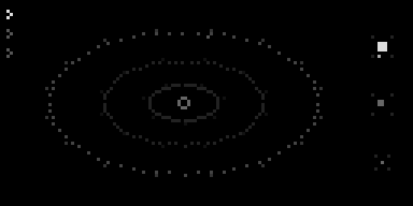
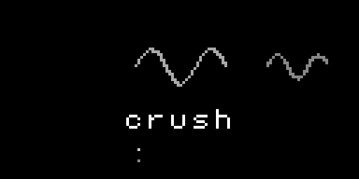
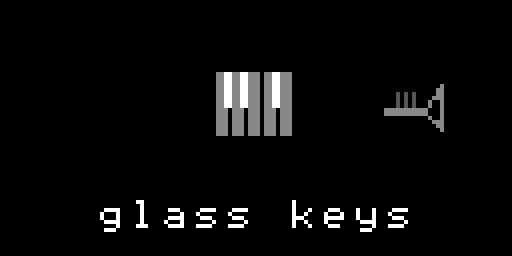

[English](README.md) · **Español** · [Français](README.fr.md) · [Deutsch](README.de.md) · [日本語](README.ja.md) · [中文](README.zh.md) · [हिन्दी](README.hi.md)

# alto

Sintetizador polifónico de tres capas para [monome norns](https://monome.org/docs/norns/),
pensado para tocarse casi solo mirando la pantalla: cada página es un dibujo
del sonido, no una lista de números.



- **3 voces** superpuestas en cada nota, cada una con su motor (18 para
  elegir), volumen, octava, afinación y LFO
- **filtro** con envolvente, seguimiento de teclado y "barrido" con K3
- **arpegiador** (4 tipos, 4 velocidades, gate hasta legato) y **modo
  acorde** (12 acordes)
- **secuenciador polirrítmico de 3 anillos**: un anillo por voz, cada uno con
  su propio largo y dirección, más melodías automáticas
- **efectos**: bitcrush, distorsión, ring modulator, reverb y un "espacio"
  granular que va de seco a nube y a shimmer
- **10 presets de fábrica + 10 lugares de usuario**
- entrada de notas MIDI desde cualquier dispositivo conectado (puertos 1 a 4)

## Requisitos

- norns (cualquiera: shield, estándar o fates)
- un teclado MIDI para tocar notas; sin teclado, alto suena a través del
  secuenciador

## Instalación

Desde maiden:

```
;install https://github.com/buenosairesfront/alto
```

Después **reiniciá la norns** (SYSTEM > RESTART) para que compile el engine
nuevo `UmaFlagship`, y cargá **alto** desde SELECT.

## Controles

En todas las páginas: **K2 + E1** cambia de página, **K1** prende/apaga el
hold (latch de notas). Cualquier tecla saltea la intro.

### 1 · play



| control | acción |
|---|---|
| E1 | espacio: seco → nube granular → shimmer |
| E2 | resonancia del filtro |
| E3 | cutoff del filtro |
| K2 | arpegiador on/off |
| K2 + E2 / E3 | tipo / velocidad del arpegio |
| K2 + E1 (menú del arp abierto) | largo de los pasos (al máximo, legato) |
| K3 | barrido de filtro (sostenido = sustain) |
| K3 mantenido 0.5 s | modo acorde on/off |

### 2 · voces



| control | acción |
|---|---|
| E1 | elegir voz |
| E2 | volumen |
| E3 | motor |
| K2 | voz on/off |
| K3 | LFO on/off |
| K3 + E1 / E2 / E3 | tempo / forma / cantidad del LFO |

Motores: sine, square, tri, fm, phys, perc, pad, pluck, gendy, formant,
pmosc, blip, lfcub, syncsaw, logistic, pink, blit, vosim.

### 3 · afinar



| control | acción |
|---|---|
| E1 | elegir voz |
| E2 / E3 | semitonos / cents |
| K2 / K3 | semitonos / cents a 0 |

### 4 · adsr



| control | acción |
|---|---|
| E2 | elegir punto |
| E3 | moverlo |
| K3 | la envolvente también maneja el filtro |

### 5 · acorde



**E2** elige el acorde del modo acorde: maj, min, sus2, sus4, dim, aug,
maj7, min7, dom7, add9, maj9, min9.

### 6 · secuenciador



Tres anillos ovalados: afuera **A**, en el medio **B**, adentro **C**. Cada
anillo toca solo su voz y tiene su propia cantidad de pasos, así las agujas se
desfasan (polirritmia). Cada paso crece hacia afuera con la altura de la nota;
un punto en la base es un silencio. El reloj va en semicorcheas y sigue el
clock de la norns.

| control | acción |
|---|---|
| K3 | play / stop (los tres anillos) |
| K3 + E1 | elegir anillo |
| K3 + E2 | dirección: adelante, reversa, ida y vuelta, random |
| K3 + E3 | anillo elegido on/off |
| K2 | grabar en el anillo elegido (si estaba parado, arranca) |
| E1 | cantidad de pasos |
| E2 | elegir paso |
| E3 | altura del paso (al mínimo, silencio) |
| K2 + E3 | duración del paso elegido |
| K2 + E2 | duración de todos los pasos (al máximo, ligados) |
| K1 + E3 | melodías automáticas (derecha nueva, izquierda atrás) |
| K1 mantenido 0.5 s | borrar el paso elegido |

### 7 · efectos



| control | acción |
|---|---|
| E1 | elegir efecto: crush, dist, ring, verb |
| E2 / E3 | sus dos parámetros |
| K2 | efecto on/off (conserva sus valores) |

### 8 · presets



| control | acción |
|---|---|
| E2 / E3 | elegir lugar |
| K2 | cargar / grabar (confirmar con K2) |
| K3 | salir |

De fábrica: glass keys, analog brass, deep sub, acid line, stellar pad,
vox choir, klavinsky, chaos drone, metal bell, perc keys.
Los presets de usuario se guardan en `~/dust/data/alto/user_presets.tab`.

<!-- u-ma:more -->
**Más de U-MA:** todos los instrumentos y herramientas en un solo lugar → [muestrario U-MA](https://github.com/buenosairesfront/U-ma/blob/main/README.es.md)
<!-- /u-ma:more -->

## Créditos

Hecho por [Buenos Aires Front](https://github.com/buenosairesfront) / U-MA.
Licencia MIT.
